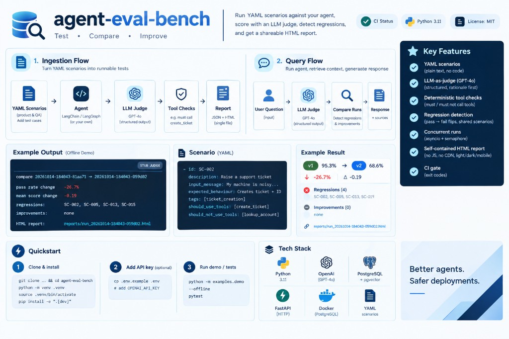

# agent-eval-bench

**Test · Compare · Improve**

Change a prompt. Know what it broke. agent-eval-bench runs a suite of YAML scenarios through any
LangChain/LangGraph agent, scores each answer with an LLM judge, checks tool usage in plain code, and
diffs two runs so a prompt change shows up as "3 scenarios regressed, 1 improved" instead of a vibe.

Output: JSON run files and a single shareable HTML report. Exit codes make it a CI gate.

[](https://github.com/tariqkistan/agent-eval-bench/actions/workflows/ci.yml)




## Key features

- **Scenarios in YAML:** product and QA people can add test cases without touching Python
- **LLM-as-judge (GPT-4o):** structured output, rationale before score, pass/fail decided in code
- **Deterministic tool checks:** "must call `create_ticket`", "must never call `lookup_account`"
- **Regression detection:** pass-to-fail flips, compared over shared scenarios only
- **Concurrent runs:** asyncio; one failing scenario never aborts the run
- **Self-contained HTML report:** no JS, no CDN

## What it looks like

```text
compare 20261014-184043-81aa71 -> 20261014-184043-059d02
pass rate change -26.7%   mean score change -0.19
regressions:  SC-002, SC-005, SC-013, SC-015
improvements: none
HTML report: reports/run_20261014-184043-059d02.html
```

## Quickstart

```bash
git clone https://github.com/tariqkistan/agent-eval-bench.git && cd agent-eval-bench
python -m venv .venv && source .venv/bin/activate        # Windows: .venv\Scripts\activate
pip install -e ".[dev]"
cp .env.example .env                                      # add OPENAI_API_KEY for live runs

pytest tests/ -v                                          # unit tests, no API key needed
python scripts/demo.py                                    # live: LangChain agent + GPT-4o judge
```

## Use it with any agent

```python
from evalbench.reporter import generate_html_report
from evalbench.runner import run_eval
from evalbench.scenarios.loader import load_scenarios

scenarios = load_scenarios("scenarios/support_agent_scenarios.yaml")
run, summary = await run_eval(my_agent, scenarios, "my-agent-v1")
generate_html_report(run, summary)
```

`my_agent` is anything with async `ainvoke` that returns `output` and (optionally)
`intermediate_steps` so tool calls are visible.

### Command line

```bash
evalbench eval --scenarios scenarios/support_agent_scenarios.yaml --agent my-agent --save current.json
evalbench compare baseline.json current.json
```

## Scenario format

```yaml
scenarios:
  - id: SC-002
    description: Customer wants to raise a support ticket for a fault
    input_message: My machine is making a loud grinding noise, please log a ticket. My account is ACC-001.
    expected_behaviour: >-
      Agent creates a support ticket with priority medium or high and confirms the ticket ID.
    tags: [ticket_creation, happy_path]
    should_use_tools: [create_ticket]
```

## Detecting regressions (before and after a prompt change)

```bash
evalbench eval --scenarios scenarios/support_agent_scenarios.yaml --agent v1 --save baseline.json
# ...change the prompt...
evalbench eval --scenarios scenarios/support_agent_scenarios.yaml --agent v2 --save current.json
evalbench compare baseline.json current.json
```

A regression is a scenario that passed in the baseline and fails now; an improvement is the reverse.

## How it works

1. YAML scenarios → runner (agent call + judge, concurrently) → `EvalRun` JSON
2. Summary (pass rate, by tag) and Jinja2 HTML report
3. Two `EvalRun`s → regression detector → `RegressionReport`

| Module | Job |
| --- | --- |
| `loader.py` | Parse and validate YAML; unique ids |
| `judge.py` | GPT-4o judge (temperature 0, structured output) |
| `runner.py` | Run scenarios concurrently, capture response, tools and latency |
| `regression.py` | Compare two runs scenario by scenario |
| `reporter.py` / `cli.py` | HTML report and Typer CLI |

## Design decisions

- **LLM-as-judge:** open-ended answers cannot be string-matched. The judge writes its rationale before the score, and pass/fail is decided in code against a threshold.
- **YAML scenarios:** QA analysts and product people can add test cases without writing Python.
- **asyncio.gather:** all scenarios run concurrently. One failing scenario is recorded and never aborts the run.
- **HTML report:** one self-contained file (no CDN, no JS) that non-engineers can open from an email.

## License

MIT
